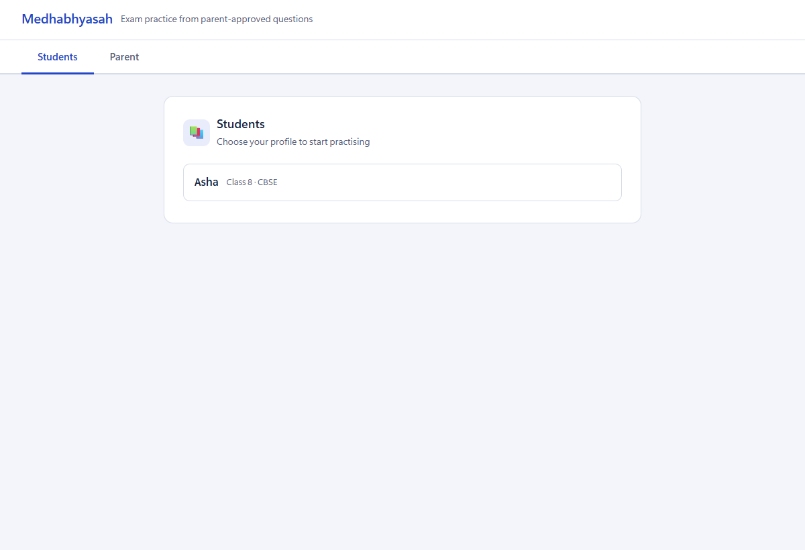
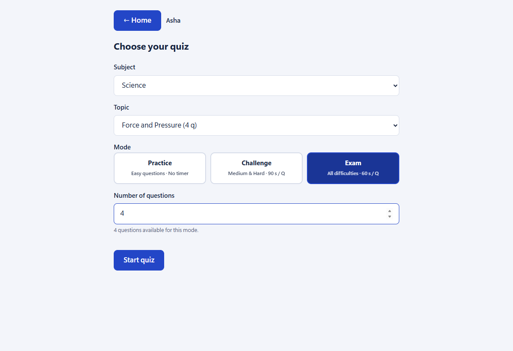
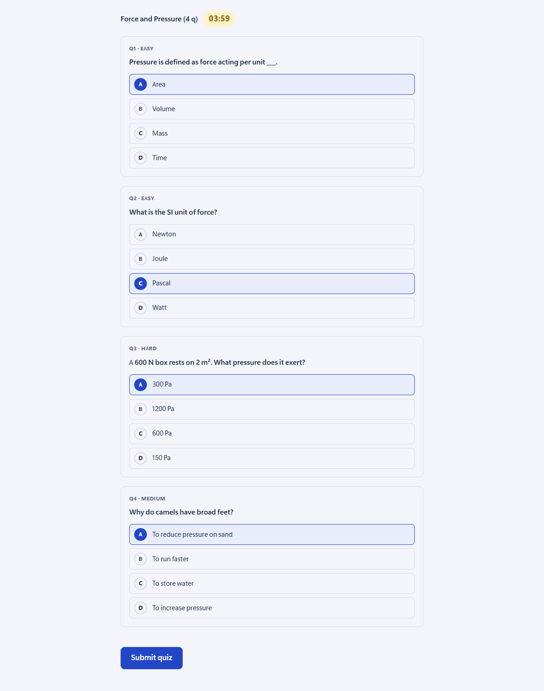
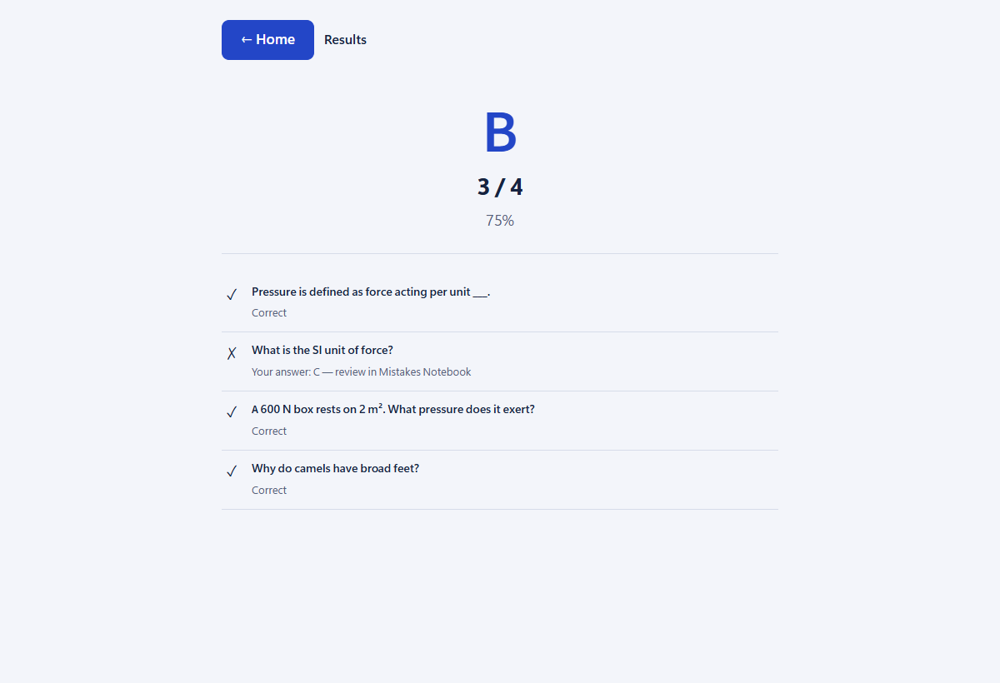
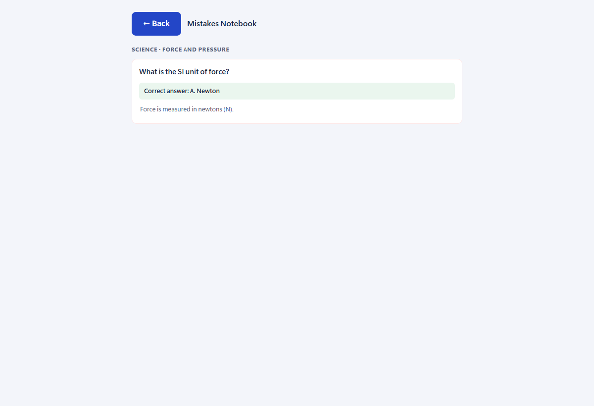
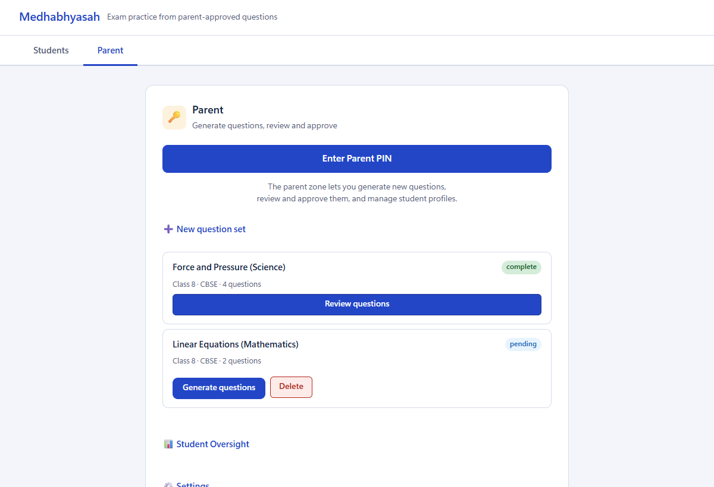

# Medhabhyasah

Medhabhyasah (*medhā* + *abhyāsaḥ*, "practice that sharpens the mind") is a Windows desktop app for exam practice. A parent generates and approves questions with AI help, and a student practises only from the approved set.

## Screenshots

| Student profiles | Choose a quiz |
| --- | --- |
|  |  |
| **Taking a quiz** | **Results** |
|  |  |
| **Mistakes Notebook** | **Parent zone** |
|  |  |

## Status

See `packaging/README.md` to build the Windows installer.

## Develop

```powershell
uv sync --extra dev
uv run pytest
uv run --extra dev pip-audit   # check dependencies for known vulnerabilities
uv run medhabhyasah
```

## Layout

| Path | Purpose |
| --- | --- |
| `src/medhabhyasah/api/` | Local FastAPI routes |
| `src/medhabhyasah/db/` | SQLite schema and data access |
| `src/medhabhyasah/generation/` | AI provider interface and question generation (parent zone only) |
| `src/medhabhyasah/safety/` | Automatic question checks |
| `src/medhabhyasah/web/` | Student and parent screens, shared styles, quiz template |
| `data/catalog/` | Syllabus catalogue |
| `data/sources/` | Local chapter PDFs (not committed) |
| `tests/` | Unit and safety tests |
| `packaging/` | PyInstaller and Inno Setup files |
| `scripts/` | Developer scripts |
